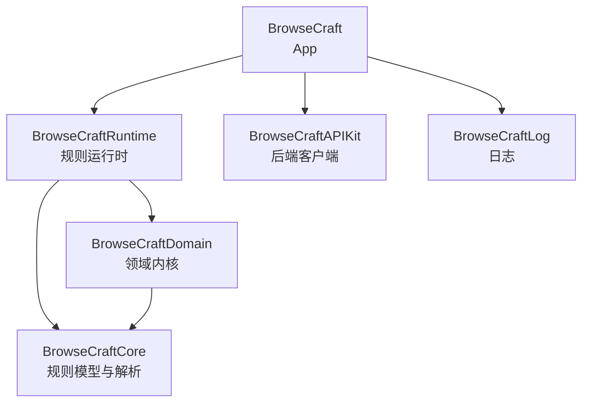
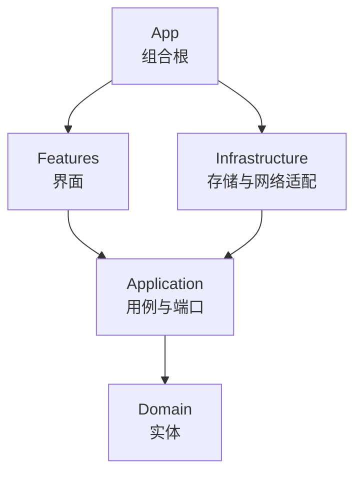

# BrowseCraft

BrowseCraft 是一个由来源规则驱动的 iOS 阅读器，支持漫画、视频、书三种内容。

## 架构

App 由本仓库与五个兄弟 Swift Package 组成，依赖方向自上而下：



App 内部分层，依赖只指向内层：



## 目录

| 路径 | 内容 |
| --- | --- |
| `BrowseCraft/` | App 源码 |
| `BrowseCraftTests/` | 单元测试 |
| `BrowseCraftUITests/` | UI 测试 |
| `Config/` | `.xcconfig` 构建配置 |
| `scripts/` | 工程维护脚本 |
| `docs/` | 文档，入口见 [docs/README.md](docs/README.md) |
| `HANDOFF.md` | 会话入口 |

## 构建

依赖由 Swift Package Manager 管理，工程由 XcodeGen 生成。增删或移动源文件后重新生成：

```bash
./scripts/regenerate-project.sh
```
